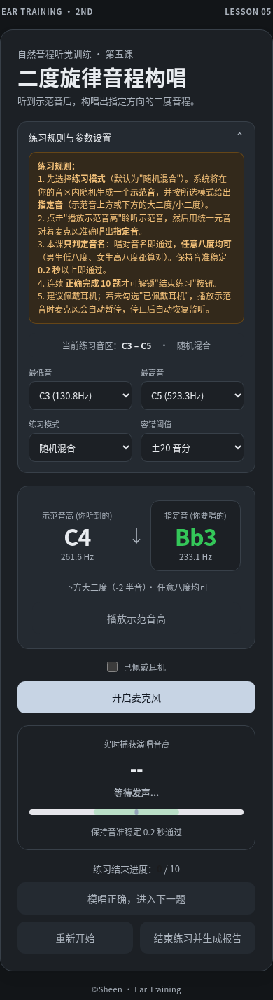
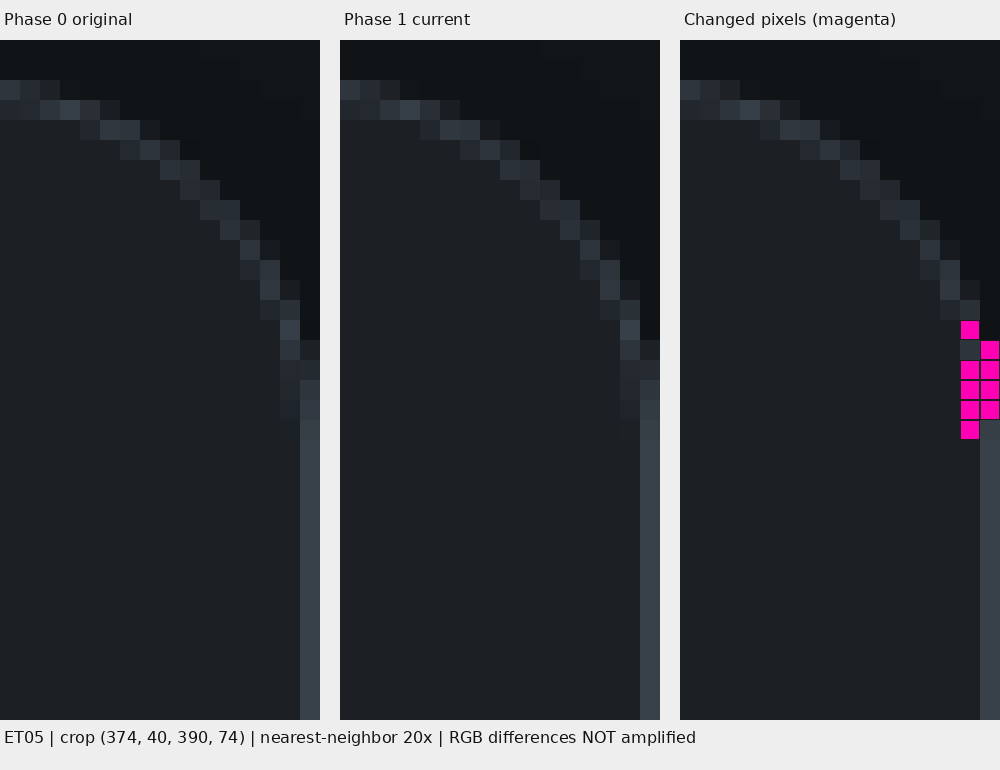
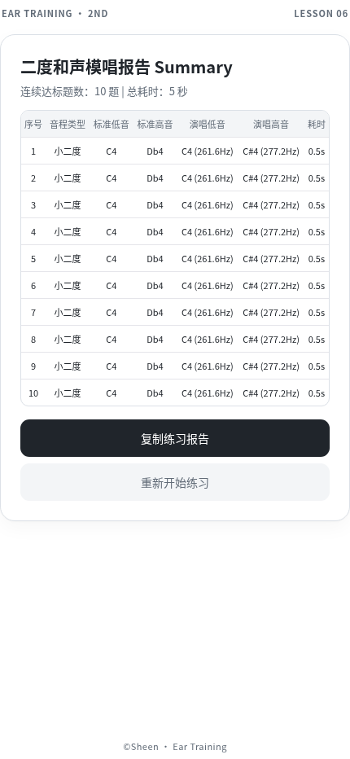
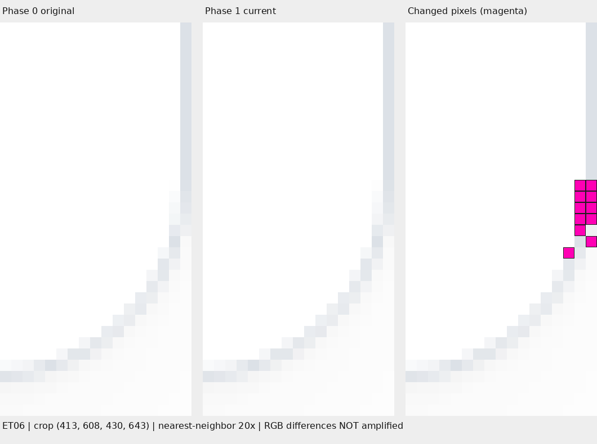

# Phase 1 最终视觉风险审核材料

状态：**人工审核材料已准备；原自动化结果仍为 FAIL / BLOCKED。没有人工批准记录。** 本报告不实施 REVIEW_REQUIRED，不提交或部署。

## 1. 版本、范围与证据完整性

集成分支 `integration/course-phase1`，HEAD `4ba6b9d3800eaa2f9e07640bd0195545b7bae9e4`；main 基准 `acd294069a670578d8bdb5ef1b0ea752e7ee2d52`；原始课程基准 `d4936c7ddbae8dfbd963c6880b1be983f2d96110`。Chromium `151.0.7922.173`、Playwright `1.62.1`，DPR 1，同浏览器模拟视口，reducedMotion=reduce。

本次未修改课程、Dashboard、Catalog 或正式测试代码；此前五个未提交测试兼容文件原样保留。原 `tests/course-baseline/results.md` 和 `/tmp/course-phase1-integration-visual.log` 未改动，原审计报告未改动。只新增本报告、审核图像、诊断 JSON 和只读诊断脚本。资源目录 `course-phase1-visual-review/manifest.json` 记录来源文件 SHA-256；原 before/after PNG 逐字节复制，放大图不替换它们。原有失败诊断逐字节复制，保留 FAIL。

完整上轮回归：43 tests，41 PASS、2 FAIL；81 对 PNG 严格一致、0 PASS_WITH_RASTER_VARIANCE、2 FAIL。370 状态成功比较；失败初始用例中断，不能声称所有 378 状态通过。行为5通过/3既有TODO，隔离16组合通过，负向2项测试通过（11种真实UI/变量变化被拒绝），语法与路径通过。音频/设备是替身，未进行真机验收。

## 2. ET05：状态重建失败与像素差异

用例：390×844、Dark、初始页面；实际全页 PNG **390×1427**。9 个不同像素、最大 RGB 通道差1、Alpha全相同。差异范围 `[388,54,390,60)`，右/下边界不含。

[原始 Phase 0 PNG](course-phase1-visual-review/et05-before.png) · [当前 Phase 1 PNG](course-phase1-visual-review/et05-after.png) · [原失败诊断](course-phase1-visual-review/et05-diagnostic.json)

放大图左/中为原色、最近邻20倍；右图洋红色仅标示发生变化的像素，不表示实际色差强度。

### 2.1 精确不一致字段

复现记录：[重建诊断](course-phase1-visual-review/et05-reconstruction-diagnostic.json)，[独立光标对照探针](course-phase1-visual-review/caret-probe.json)。使用与正式用例相同的截图顺序，记录首次期望状态、截图后的参考状态、全新参考页还原前/后及正式 snapshot 验证后；诊断只跑固定至多8个重建槽位，第一槽已复现不一致即停止，不增加验收采样。ET06未新增参考截图。

**唯一不一致字段是 `snapshot.dom` 中 `#headphoneCheckbox` 的空 style 属性。**

| 时点 | 具体期望/实际 |
|---|---|
| 原期望节点 | `<input type="checkbox" id="headphoneCheckbox" onchange="handleHeadphoneToggle()">`，`getAttribute('style') === null` |
| 原参考页截图后 | 相同节点多出 `style=""`，`getAttribute('style') === ""` |
| 全新参考页，还原前 | 与期望完全一致，0字段差异 |
| `document.body.innerHTML = body` 还原后 | 复制的 body 已带 `style=""`；仅 `snapshot.dom` 不一致 |
| snapshot结束动画/归零滚动并验证后 | 仍仅 `snapshot.dom` 不一致；DOM字符串长度29370→29379，差异偏移7257 |

全部普通样式、伪元素、变量、几何及computedStylesHash相同；checkbox checked=false、disabled=false、value="on"、焦点BODY、计算caret-color `rgb(255,255,255)`均相同。不是课程内容、颜色、尺寸、变量或交互状态变化。

**原因链：** `visual.test.cjs:28` 在截图前保存expected；`:35` 调用默认caret隐藏的screenshot；`visual-state.cjs:50` 在截图后序列化参考body；`:54` 还原时复制了截图工具留下的空属性；`:56` 使用原截图前expected严格比较，触发拒绝。

环境中 Playwright `playwright-core/lib/coreBundle.js:21116–21129` 对所有 `input,textarea,[contenteditable]` 写入 `caret-color: transparent !important`，清理只恢复属性值，未恢复原本不存在的style属性；`:21263` 默认 `options.caret !== "initial"` 触发该处理。只读探针证明默认 `caret:hide` 使null→空字符串，而 `caret:initial` 保持null。这是截图工具副作用加夹具采样时点不一致造成的**已确认重建测试机制缺陷**，不需要放宽DOM比较。

重要局限：上轮失败只保存泛化reason，没有保存expected与失败replay的完整状态。因此无法从历史记录直接回读其具体字段；上述是同一代码/同一流程的明确因果复现，不能宣称有历史字段快照。不是仅因后续重跑通过而判定。

### 2.2 与九像素差异的因果关系

空style属性在截图清理后产生，重建前已经存在；它直接导致独立参考状态拒绝。对该checkbox的计算样式/交互/卡片几何无影响，没有针对它的空style属性教学样式选择器。**未证明它导致practiceCard右上角的RGB变化**，也不能用已确认的重建缺陷替代九像素来源证明。

复现测量practiceCard矩形 `[0,42,390,1344.203125]`，右上半径18px，边框1px，transform none；外圆中心 `(372,60)`，内圆半径17px。差异像素面积与右上圆角内/外曲线相交，局部有抗锯齿梯度，位于视口右边界；边界位置不是豁免理由。

ET05分类：**B（重建状态拒绝已确认测试机制缺陷）；其PNG微差异本身为C（高度疑似栅格不确定性，来源证明不足）**。视觉影响低，自动化证据可靠性问题中等。

| 坐标 (x,y) | Phase 0 RGBA | Phase 1 RGBA |
|---|---|---|
| (388,54) | [54, 62, 71, 255] | [55, 63, 72, 255] |
| (389,55) | [28, 33, 37, 255] | [28, 33, 38, 255] |
| (388,56) | [37, 41, 47, 255] | [36, 41, 48, 255] |
| (389,56) | [36, 43, 48, 255] | [37, 43, 49, 255] |
| (388,57) | [35, 40, 45, 255] | [35, 40, 46, 255] |
| (389,57) | [46, 53, 60, 255] | [46, 53, 61, 255] |
| (388,58) | [31, 36, 42, 255] | [32, 36, 42, 255] |
| (389,58) | [50, 57, 66, 255] | [50, 58, 66, 255] |
| (388,59) | [28, 33, 38, 255] | [29, 33, 38, 255] |

## 3. ET06：未独立重现的圆角栅格

用例：430×932、Light、报告页；两图均 **430×932**，11像素，最大RGB差2，Alpha相同。差异范围 `[427,622,430,629)`；未经新的采样或阈值调整。

[原始 Phase 0 PNG](course-phase1-visual-review/et06-before.png) · [当前 Phase 1 PNG](course-phase1-visual-review/et06-after.png) · [原失败诊断](course-phase1-visual-review/et06-diagnostic.json)

逐像素重新解码验证，两图只包含下表11处变化，与原诊断逐项一致，图片Alpha通道均255。没有主体或文字像素变化。

| 坐标 (x,y) | Phase 0 RGBA | Phase 1 RGBA |
|---|---|---|
| (428,622) | [254, 254, 254, 255] | [253, 253, 253, 255] |
| (429,622) | [221, 226, 232, 255] | [221, 226, 231, 255] |
| (428,623) | [250, 251, 252, 255] | [249, 250, 251, 255] |
| (429,623) | [225, 229, 234, 255] | [224, 228, 233, 255] |
| (428,624) | [246, 248, 249, 255] | [246, 247, 249, 255] |
| (429,624) | [228, 231, 236, 255] | [227, 231, 235, 255] |
| (428,625) | [243, 246, 247, 255] | [243, 244, 246, 255] |
| (429,625) | [233, 236, 239, 255] | [232, 235, 238, 255] |
| (428,626) | [231, 234, 239, 255] | [230, 234, 238, 255] |
| (429,627) | [249, 249, 249, 255] | [248, 248, 248, 255] |
| (427,628) | [245, 247, 249, 255] | [245, 247, 248, 255] |

[原课程报告状态的几何重建记录](course-phase1-visual-review/et06-geometry.json)：通过原成功处理器与finishPractice构造原十题报告，不修改课程源码，不生成新的参考PNG。Phase 0/1全量snapshot一致。reportCard矩形 `[0,42,430,598]`，底边y=640、右边x=430；右下半径18px、四边1px、transform none。外圆中心 `(412,622)`，外半径18px、内半径17px，圆角位于实际视口右边缘。像素 y=622..628 属于右下弧顶端附近；通过原几何/局部梯度候选判定，不能仅凭“在右边缘”放行。

原固定八次 Phase 0 重建全部状态有效，八张PNG仍在 `/tmp/course-phase1-integration/visual/ET06-430x932-light-report-same-source-{0..7}.png`，哈希记录在manifest。目标完整栅格未出现在八张证据中；**有限样本未重现不能证明真实CSS回归，也不能证明是随机噪声**。本次没有扩充采样次数。

ET06分类：**C：高度疑似栅格不确定性，但证据不足**。视觉风险低；没有确认判定器缺陷，它依照既定来源证明条件保守拒绝是正确行为。

## 4. 真实回归风险与保护范围

| 证据 | ET05 | ET06 | 局限 |
|---|---|---|---|
| Git源码 | 教学body/脚本对Phase0逐字节相同 | 同左 | CSS迁移本身是有意变更，不能仅凭JS相同证明视觉 |
| Phase1版本 | 六个生产文件与已验收work分支相同 | 同左 | 同代码可能因浏览器产生不同栅格 |
| 当前main隔离 | Dashboard/Catalog/部署/其他课无额外差异 | 同左 | 不替代真机全面业务验证 |
| 初始原图对新图 | DOM/文本/样式/伪元素/变量/几何/状态严格一致 | 报告状态严格一致 | 原失败未留完整状态明细，诊断structureChanged=false；新只读重建补充细节 |
| 行为 | 四种构唱模式/十题报告通过 | 和声/低高独立采集/十题报告通过 | 真音频、麦克风权限、人声、Safari未验 |
| PNG | 9处、RGB≤1、Alpha一致、圆角候选 | 11处、RGB≤2、Alpha一致、圆角候选 | 不能证明Chromium内部合成机制或全部设备一致 |
| 独立来源证明 | 被截图副作用污染的重建状态阻断 | 8有效样本未含目标 | 两者均没有满足自动通过来源证明 |

**没有发现已确认真实视觉回归（A）的证据；也没有将两项FAIL当作PASS。** 低风险指已观察差异的影响，不是完整证明“绝无回归”。模唱与构唱及各报告继续独立保护。

## 5. 人工审核建议

建议审核人打开两张全页图，在100%缩放检查内容/报告/控件布局，再检查20倍图和全部20个RGBA样本，确认只涉及圆角微差异。建议**人工批准这两处限定视觉差异**，前提是审核人明确接受来源证明不足的剩余风险；批准只针对本报告的版本、状态和PNG哈希，不代表自动化通过、不批准其他失败，也不替代麦克风/Safari/iPad真机验收。

ET05的夹具缺陷值得另立测试修复：保留截图前参考state和body的同一时间点，或使截图处理严格恢复原属性，再进行专门回归。该建议不在本次实施；不能删除空style差异断言或全局忽略style属性。

现在可以进入**人工视觉风险审核**。在有明确批准记录、测试兼容调整独立提交并重新核对最终版本之前，仍不建议把自动部署条件标为READY。没有授权合并/推送/部署。

## 6. REVIEW_REQUIRED 的最小方案（仅提案，未实施）

1. 保留现有PASS/PASS_WITH_RASTER_VARIANCE/FAIL和原日志；新增独立审核字段 `reviewStatus: REVIEW_REQUIRED`。候选不计PASS。
2. 候选须已有全部严格课程结构/文本/普通样式/伪元素/几何/变量/按钮/动画/行为通过，且PNG满足现有有限圆角几何、局部连通、RGB/Alpha/区域限制。真实结构/样式差异仍FAIL且不可用视觉审批豁免。ET05重建副作用只作为已调查的证据失败原因，不豁免原课程结构。
3. 只允许“独立来源证明不足”或“已诊断的证据夹具副作用”进入人工队列。不得新增阈值或忽略区域，不扩样、不更新基线；其他原因继续阻塞。
4. 审核记录绑定最终候选提交/未提交差异哈希、Phase0基准、两个PNG哈希、用例、原诊断、审核人、时间、明确APPROVED/REJECTED及理由。待审核/拒绝均阻塞；源码、测试或证据变动使批准失效。
5. 发布门禁只能在所有自动通过，或每一项限定REVIEW_REQUIRED均有明确有效人工批准后继续。应呈现“自动FAIL＋人工例外批准”，不得改写为PASS，缺审批非零退出/阻塞。部署仍须另外授权，批准视觉不自动触发发布。

本报告无审核人签署、无APPROVED值；未修改测试状态或门禁。所有原始失败文件和结果保持不变。
